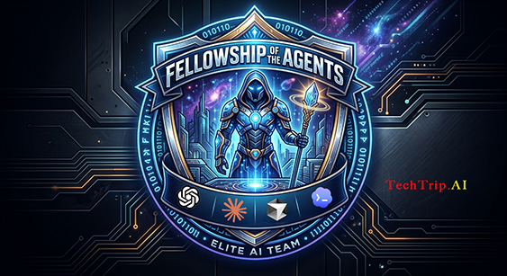

# TechTrip-AI-plugins

<p align="center">
  
</p>

**Everything TechTrip AI releases, in one catalog.** Add this marketplace once and install what
you need. Nothing is hosted in this repository: it is the index, and every entry points at the
repository where that plugin lives. The same file serves Claude Code and GitHub Copilot CLI.
Every TechTrip plugin ships a `brain-dump` skill: a menu-driven tour that teaches you how to
use it and hands you the exact prompts to type, so "how did this work again?" three weeks from
now is never a search.

## Quick start

Inside Claude Code:

```
/plugin marketplace add TechTripAi/TechTrip-AI-plugins
/plugin install claude-sessions@TechTrip-AI-plugins
/claude-sessions:brain-dump
```

The first line registers the marketplace on your machine. The second installs one plugin at
user scope, so it is available in every project. The third starts its tour.

## What is in the catalog

| Plugin | What it does | Lives in | Start here |
|---|---|---|---|
| claude-sessions | Find, list, resume and summarize past Claude Code sessions across every project on this machine or just the current directory: directory, session id, status, last active, the last thing you said, and the exact resume command; plus a brief or full summary of any session, on screen or as a markdown file, that tells you what happened, where it stands and what it cost. Flags sessions still running elsewhere so you do not fork them by accident. | [techtrip-claude-plugins](https://github.com/TechTripAi/techtrip-claude-plugins) | `/claude-sessions:brain-dump` |
| techtrip-secondbrain | One-command bootstrapper for a generic LLM Wiki second brain on a fresh Mac: Obsidian, the claude-obsidian companion, a clean vault, the Obsidian MCP server, source-fetch skills (YouTube, X, voice, code, NotebookLM), git sync and backup. Harness-agnostic skills with Claude Code, Cursor and Copilot templates. | [techtrip-secondbrain](https://github.com/TechTripAi/techtrip-secondbrain) | `/techtrip-secondbrain:brain-dump` |
| claude-obsidian | TechTrip AI's maintained fork of [AgriciDaniel's claude-obsidian](https://github.com/AgriciDaniel/claude-obsidian) (MIT), a self-organizing AI second brain for Obsidian + Claude Code. Maintained independently; original credit and license retained. Installed for you by techtrip-secondbrain, or on its own from here. | [claude-obsidian](https://github.com/TechTripAi/claude-obsidian) | its README |

Install any of them the same way:

```
/plugin install techtrip-secondbrain@TechTrip-AI-plugins
/plugin install claude-obsidian@TechTrip-AI-plugins
```

This catalog is the only marketplace for all of them; the plugins' own repositories carry no
public marketplace of their own. More will land here as they are built, including packs for
engineering, education and business.

## How TechTrip AI repositories are organized

```
TechTripAi/
├── TechTrip-AI-plugins        this catalog: .claude-plugin/marketplace.json, README, LICENSE
├── techtrip-claude-plugins    Claude Code–only tools, several plugins under plugins/<name>/
│   └── plugins/claude-sessions
├── techtrip-secondbrain       a product: one plugin at the repository root
└── claude-obsidian            a maintained fork: one plugin at the repository root
```

One repository per domain. A domain that only makes sense inside Claude Code may hold several
small plugins in one repository; the catalog points at each with a `git-subdir` entry. A domain
that serves other harnesses too is one plugin at its repository root, with many skills, because
Copilot CLI reads this same catalog but cannot point into a subdirectory. Related skills inside
a plugin stay flat under `skills/` and share a name prefix; they are never grouped by folder,
which the Agent Plugins specification forbids.

### Naming

- Products carry the `techtrip-` prefix (`techtrip-secondbrain`): the plugin name travels
  without the organisation, as `/techtrip-secondbrain:brain-dump`, so it has to be distinctive
  on its own.
- Forks keep their upstream name (`claude-obsidian`).
- Claude-specific tools are named for what they do (`claude-sessions`).
- A published name never changes. Labels change through `displayName`; an unavoidable rename
  goes through this catalog's `renames` map so existing installs migrate.

## Other harnesses

- **GitHub Copilot CLI** reads this same file:
  `copilot plugin marketplace add TechTripAi/TechTrip-AI-plugins`, then
  `copilot plugin install techtrip-secondbrain@TechTrip-AI-plugins`. Entries that point into
  a subdirectory (the Claude-only tools) are not installable from Copilot, by design.
- **Anything that reads `SKILL.md`** (Cursor, Codex, and the rest, via [skills.sh](https://skills.sh))
  can take the skills of any plugin repository directly:
  `npx skills add TechTripAi/techtrip-secondbrain`.

## Releases and updating

Each plugin's own `plugin.json` is its version of record; the entry here mirrors it, and a
release is complete only when both say the same thing. To pick up releases:

```
/plugin marketplace update TechTrip-AI-plugins
/plugin update claude-sessions@TechTrip-AI-plugins
```

Auto-update is off for third-party marketplaces by default; turn it on for this one under
**Marketplaces** in `/plugin` if you want releases without the two commands.

## License

[FSL-1.1-MIT](LICENSE.md). Functional Source License: free to use, modify and redistribute
for anything except a competing product, and it converts to MIT two years after each release.
Each plugin repository carries its own license file.

## Credits

Built by [Terry Trippany](https://github.com/TechTripAi) (Try AI Solutions) with Claude Code.
The "Fellowship of the Agents" artwork is TechTrip's.
